 

<a href="https://nyando-flood-ai.vercel.app/">🌊 Live dashboard</a> &nbsp;|&nbsp;
<a href="https://github.com/jameskoero/nyando-flood-ai">💻 Source code</a> &nbsp;|&nbsp;
<a href="https://doi.org/10.5281/zenodo.23919053">📄 v2.0.0 on Zenodo</a> &nbsp;|&nbsp;
<a href="https://www.linkedin.com/in/jameskoero">💼 LinkedIn</a> &nbsp;|&nbsp;
<a href="https://orcid.org/0009-0001-8314-2682">🆔 ORCID</a>

## 👋 Hello, I am James

**I build machine learning systems, then try to break them.** In 2026 I audited my own flood model, found that its headline metric was circular, retracted it, and rebuilt the whole system from real satellite data under strict leakage control. The rebuild is public, released as v2.0.0, and every number below can be re-derived from files in the repository.

I came to ML from physics and geophysics: B.Sc. Physics and Mathematics (Moi University), a geophysics attachment at KenGen Olkaria, then seven years in Kenyan insurance and investment distribution. Everything here was built on an Android phone with Termux and Google Colab, over mobile data.

**What I do**

- 🛰️ **Build end-to-end systems**, from raw satellite data to a live API and dashboard.
- 🧪 **Validate honestly:** event-based cross-validation, sealed test sets, and public retractions of my own results.
- 📦 **Ship reproducibly:** ONNX models verified by SHA-256, hash-locked Docker images, CI gates on data and claims.
- 🛡️ **Add LLMs safely:** output guards and deterministic fallbacks.
- 📐 **Use physics as a prior:** monotonic constraints and physical baselines.

## 📊 Nyando Flood AI V2 at a glance

<table align="center">
<tr align="center">
<td width="50%"><h2>0.971</h2>per-event mean AUC 27 sealed events, scored once</td>
<td width="50%"><h2>+0.038</h2>gain over elevation alone 95% interval 0.019 to 0.061, 50 events</td>
</tr>
<tr align="center">
<td width="50%"><h2>4,420</h2>real samples 35 Sentinel-1 scene dates</td>
<td width="50%"><h2>96</h2>test files in CI plus a 58-row deviation register</td>
</tr>
</table>

## 🌊 Flagship: Nyando Flood AI V2

An open-source system that ranks flood susceptibility across five wards of the Nyando basin in Kenya.

| What | Result |
|---|---|
| Data | Copernicus GFM labels and Google Earth Engine features. No synthetic data. |
| Sealed test | 27 held-out flood events, scored once under rules fixed in advance |
| Ranking skill | Per-event mean AUC 0.971, against 0.939 for ranking by elevation alone |
| Where it does not hold | Not shown under a 1 km spatial buffer or an out-of-time split. The model card says so. |

- **Model:** gradient boosting with monotonic constraints, chosen against logistic, XGBoost and a PyTorch physics-constrained neural network. The network violated the constraints, so I did not ship it.
- **Serving:** custom ONNX exporter (parity 3.3e-16), FastAPI service that verifies the model's SHA-256 before loading, rate limiting, security headers, hash-locked Docker image.
- **Engineering:** GitHub Actions gates for data, manifests and README claims, CodeQL, MLflow tracking on DagsHub, and a deviation register that tests enforce.
- **LLM layer:** an advisory service (Gemini, Groq fallback, deterministic template) behind an output guard, plus an MCP server and a LangGraph pipeline. One model passed my guard 6 of 6 times yet named the correct drivers 0 of 6, so driver text now comes only from the template.

> Scores are rankings from a case-control sample. They are not flood probabilities, forecasts or official warnings.

## 🧰 Tech stack

**Machine learning** 
        

**Validation and statistics** 
     

**Geospatial** 
   

**MLOps and delivery** 
        

**Backend and web** 
     

**LLM and agents** 
    

## 🚀 More projects

<table>
<tr>
<td valign="top" width="50%">
<b>🏦 Loan Default Risk</b> 
Credit-default model on German Credit data (GradientBoosting). Cost-optimised threshold 0.22 from a 5:1 false-negative cost matrix. Test ROC-AUC 0.791, Gini 0.582, recall 0.833. I corrected my own overstated README metrics to these verified values. 
<a href="https://github.com/jameskoero/loan-risk-assessment">Code</a> | <a href="https://jameskoero-loan-risk-assessment-h84.vercel.app/">App</a>
</td>
<td valign="top" width="50%">
<b>💰 AfriSalaries</b> 
Salary-band classifier across 8 African markets (FastAPI, XGBoost, TF-IDF, SHAP). 1,526 real records, 59.5% band accuracy. Two regression designs rejected on validation grounds. 
<a href="https://github.com/jameskoero/afrisalaries">Code</a> | <a href="https://afrisalaries.vercel.app">App</a>
</td>
</tr>
<tr>
<td valign="top" width="50%">
<b>🥇 Kenya at Gold</b> 
Open dataset and API on Kenya's 39 Olympic golds, with a four-dimension governance framework (FastAPI, SQLite). Code MIT, data CC-BY 4.0. 
<a href="https://github.com/jameskoero/kenya-gold-ledger">Code</a> | <a href="https://kenya-gold-ledger.vercel.app">Dashboard</a>
</td>
<td valign="top" width="50%">
<b>🏢 ChurchOS</b> 
Multi-tenant church management SaaS: JWT auth, 5-role access control, finance audit log, M-Pesa and Flutterwave integration. Phase 1 live. 
<a href="https://github.com/jameskoero/ChurchOS">Code</a> | <a href="https://churchos-app.vercel.app">App</a>
</td>
</tr>
<tr>
<td valign="top" width="50%">
<b>🧩 SegmentIQ</b> 
K-Means customer segmentation, 5 segments, CSV batch upload (FastAPI, React). 
<a href="https://github.com/jameskoero/kmeans-customer-segmentation">Code</a> | <a href="https://kmeans-customer-segmentation.vercel.app">App</a>
</td>
<td valign="top" width="50%">
<b>🚢 Titanic Survival</b> 
Leak-free scikit-learn pipeline, hold-out ROC-AUC 0.8661 with bootstrap 95% intervals. 
<a href="https://github.com/jameskoero/titanic-survival-prediction">Code</a> | <a href="https://doi.org/10.5281/zenodo.20387973">DOI</a>
</td>
</tr>
</table>

## 🎯 Currently

- Building Sokoni, a WhatsApp AI sales agent for Kenyan SMEs. The backend is scaffolded and the agent logic is not built yet.
- Learning retrieval-augmented generation and model fine-tuning. Nothing shipped yet.
- **Open to remote Machine Learning Engineer, MLOps and Applied Scientist roles.**

## 🎓 Education and certifications

- B.Sc. Physics and Mathematics, Moi University, 2012
- Machine Learning using Python, Google Developers Launchpad (Certificate of Excellence), 2025
- Python Basics, Programiz, 2025

> I came into ML from geophysics, where a wrong model can mean a wrong drilling decision. That is why every model I ship comes with what its number means, and what it does not.

